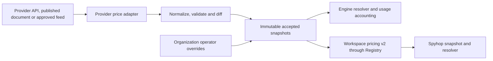

# OIP-015: Conditional model prices and dynamic provider price sources

- _Author(s)_: Pengcheng Jiang (@jiangpengcheng), AI-assisted draft for human review
- _Status_: Proposed
- _Proposal time_: 2026-10-28
- _Components_: registry-service-ts, harness-catalog, usage producers, SDKs, Helm chart; downstream
  Workspace Registry and Spyhop
- _Discussion_: Design review in the pull request introducing this proposal
- _Implementation_: None
- _Released in_: None

## TL;DR

A model can have different token prices depending on its actual service tier and the input length of
one request. Replace the single-price assumption with explicit conditional price rules, and refresh
those rules through bounded provider adapters that publish immutable snapshots. Preserve the v1
price contract for compatible standard prices; upgrade accounting and downstream consumers before
activating prices that v1 cannot express. This PR proposes the design only.

## Background

[OIP-010](OIP-010-guardrails-pricing-and-spend.md) and
[Model Pricing](../docs/managed-agents/pricing.md) define organization operator overrides,
deployment-global upstream/seed prices, provider isolation and immutable recorded cost. The current
[price contract](../services/registry-service-ts/src/contracts/model-prices.contract.ts) represents
one rate tuple per provider/model/source/organization, without request conditions. The
[refresher](../services/registry-service-ts/src/pricing/refresher.ts) handles one configured
provider feed, and
[usage accounting](../services/registry-service-ts/src/domain/usage-accounting.ts) prices normalized
usage without a service tier or a per-request context band.

## Motivation

Those assumptions cannot represent a standard price and a priority price for the same model, or a
price that changes for the whole request after a context threshold. OpenAI documents
[actual service tiers](https://developers.openai.com/api/docs/guides/fast-mode) and
[whole-request context-dependent prices](https://developers.openai.com/api/docs/models/gpt-6.1-sol).
These are examples of provider rules, not a universal provider schema or permission to infer a
missing tier. A discovered model is also not evidence of a price or permission to call it.

Keeping only a larger static seed misses future repricing. Conversely, fetching a provider on every
accounting request couples budget availability to a remote website or API. Both problems need one
contract between price acquisition, authoritative publication and price resolution.

## Goals

### In scope

- Exact provider/model identity, actual `service_tier`, and request-input-token intervals.
- Explicit rate tuples, deterministic resolution and an auditable rule/snapshot identity.
- Dynamic acquisition from multiple providers, independent refresh/failure handling, validation,
  provenance and atomic publication; no inference calls for price discovery.
- v1 compatibility, conversion of existing prices, version skew and rollback constraints.
- Engine accounting, Workspace Registry proxy/SDK changes, and Spyhop snapshot/matcher adoption.

### Out of scope

- Changing model admission, provider credentials for inference, Gateway grants or Session pins.
- Taxes, currency conversion, subscription/credit allocation, invoicing or automatic historical
  repricing. API-equivalent estimates do not establish a ChatGPT subscription bill.
- New audio/image/tool-call billing units, arbitrary expression-based pricing, regional selectors or
  a general cache-lifetime schema. An unsupported nonzero usage bucket remains unpriced.
- Claiming that every provider exposes a price API, or that a model-list API necessarily contains
  prices. Each adapter must establish its own source and coverage.

## Design

### High-level design



The Engine owns price publication and organization precedence. Provider adapters supply price
evidence; they cannot authorize inference or change token usage. A Workspace Registry forwards the
selected Engine surface. Spyhop consumes the same versioned rules but retains its existing event
identity, tenant and budget-subject authority. It does not submit a second Engine usage charge for
an event it observes.

### Detailed design

#### Price rule and request facts

A price rule has a stable opaque `rule_id` and immutable `revision`, with these fields:

| Part       | Fields and meaning                                                                                                                              |
| ---------- | ----------------------------------------------------------------------------------------------------------------------------------------------- |
| Identity   | `provider`, literal `model_id`; provider/model aliases require explicit adapter evidence                                                        |
| Conditions | One canonical `service_tier`; `request_input_tokens` with inclusive `min` and exclusive `max`, where an explicit `null` maximum means unbounded |
| Rates      | The existing input/output/cache rate tuple, USD per million tokens, with the current precision and positive-base/nonnegative-cache validation   |
| Authority  | `source` (`operator`, `upstream`, `seed`); organization scope is server-owned, never caller-selected on workspace requests                      |
| Provenance | Provider source ID, source document/version/hash, adapter version, observation/publication times and optional provider effective time           |

For example, the following conditions are illustrative, not published provider prices:

```json
{
  "provider": "example-provider",
  "model_id": "example-text-model",
  "conditions": {
    "service_tier": "standard",
    "request_input_tokens": { "min": 0, "max": 100001 }
  },
  "rates": {
    "input_per_million_tokens": 1,
    "output_per_million_tokens": 4,
    "cache_read_per_million_tokens": 0.1,
    "cache_write_per_million_tokens": 1.25
  }
}
```

A second rule starts at `100001` for a provider whose higher band begins above 100,000 input tokens.
The selected rate tuple applies to the **entire request**, not just tokens above the threshold. This
OIP does not introduce progressive/marginal pricing.

Token bands are half-open intervals `[min, max)` over integer token counts; `max: null` means
positive infinity. Provider wording such as “up to and including 100,000” therefore maps to
`[0, 100001)`, with 100,000 in the lower band and 100,001 in the next band. Bounds are nonnegative
safe integers with `min < max` for a bounded interval. Both keys are required: omitted, negative,
fractional and empty bounds are rejected rather than defaulted.

Pricing facts accompany each completed model request: actual provider/model, actual response tier,
full request input-token count, normalized usage buckets, request/report identity and evidence
source. Full input includes cached tokens exactly once; it is not the model's context capacity, an
output limit, or a sum of multiple requests. An adapter must reconcile provider inclusive counters
with normalized exclusive input/cache buckets before pricing.

Normalize tier aliases only through a reviewed provider profile, whose version is included in the
snapshot. For example, a supported OpenAI profile can normalize `priority`/`fast` together and
`default` to `standard`. `auto` is a request selection mode, not proof of the actual tier. An absent
tier or unavailable full input count is unknown, not a wildcard or zero. A documented legacy adapter
may supply a known standard tier; a caller's requested tier alone cannot override the observed
response tier.

Keep existing token/cost arithmetic, including reasoning within output. Explicitly materialize the
effective legacy cache rates during reviewed conversion, preserving its existing arithmetic; do not
apply an Anthropic cache ratio to every newly fetched provider. A nonzero usage bucket without a
supported rate, or an unsupported cache-lifetime fact, returns `UNPRICED` rather than being ignored.
In v2 a cache rate is an explicit supported number or `null` for unsupported; `null` never requests
implicit rate derivation. The existing 5m/1h interpretation remains valid only in its admitted
legacy usage profile; other lifetimes are not relabelled to fit it. A known zero bucket needs no
rate.

#### Resolution and conflicts

1. Bind organization from authenticated workspace context. Admit only that organization's operator
   rules and deployment-global upstream/seed rules.
2. Require an exact provider/model identity after explicit alias normalization. v2 does not guess a
   new model's price by trimming its name; v1 keeps its existing snapshot/family behavior.
3. Require the actual canonical tier and a known full input count, then select rules whose interval
   contains it and whose publication is eligible at the pricing time.
4. Among eligible rules, retain `operator > upstream > seed`. Do not merge token rates from
   different rules. A standard operator rule cannot match a priority request.
5. At the winning source, exactly one rule must match. Reject intersecting intervals for the same
   identity/tier/source/scope in an active rule set, including duplicate aliases. A gap, unexpected
   overlap, unknown fact or unsupported required feature returns a structured unpriced reason. Array
   order, lowest price and narrowest interval are not tie-breakers.

For source fallback, the lower source must independently declare the same tier and covering
interval. An absent priority rule never falls back to a standard rule. No wildcard tier exists in
the first version. Operators can explicitly publish a flat standard interval if that is their
organization's intended price policy.

Use the injected server clock and the catalog active at **first authoritative accounting
acceptance** as `pricing_time`, preserving current report-time semantics. Provider effective time is
separate from fetch/publication time: future-effective rules cannot activate early, and a newly
fetched backdated price does not rewrite already accepted usage. Keep the request's observed time
for audit; an untrusted client timestamp cannot select an older/cheaper catalog. This is metering
under an accepted tariff, not a promise to reproduce a provider invoice.

For first acceptance at `T`, a rule is eligible only in the catalog selected for `T`, with
`catalog.published_at <= T`, and either no provider effective time or
`rule.provider_effective_at <= T`. Its recorded activation/retirement and source-validity bounds
must also contain `T`. Thus a rule published at 10:00 and effective at 11:00 is eligible at 12:00,
but not at 10:30; equality at 11:00 is eligible. A scheduled replacement keeps the previous valid
model set active, subject to unchanged freshness limits, until the effective boundary, then
activates a coherent replacement atomically. It must not expose two overlapping active sets or
discard a valid old set early. A backdated rule published after a receipt was accepted cannot become
eligible for that receipt on replay.

#### Immutable catalogs and cost receipts

Publishing produces `catalog_id`, generation, content digest, required feature set and validity
metadata. A whole model's tier/range set changes atomically; replacing one boundary must not expose
a temporary gap or overlap. Operator edits create new revisions and immutable audit events. Provider
refresh never changes operator rules.

Freshness is evaluated per model/source, so one expired provider does not invalidate other valid
providers. Clients enforce those validity bounds even while retaining an unchanged catalog.

Each first-accepted usage record retains its facts, matched rule/revision, catalog ID, pricing time,
rate tuple, cost and price basis. Duplicate reports reuse that receipt and its cost even if a
refresh occurred between attempts. An unpriced receipt retains a reason and the facts that were
absent. Corrections/revaluations, if added later, require a separate audited operation; replay,
cache refresh and rule deletion do not mutate historical spend.

#### Dynamic provider price acquisition

One installed adapter per supported source format normalizes price evidence into the v2 model rule
sets. Initial implementation covers OpenAI and Anthropic public list-price sources plus a normalized
JSON feed for other providers. An adapter declares its provider, source kind, trusted origins,
supported tier aliases/units/context semantics, completeness contract and parser version. Adapters
are packaged code, not uploaded scripts or workspace-controlled URLs.

Source kinds are a documented provider price API, a published provider document with a versioned
extractor, or an operator-approved normalized feed that retains upstream provenance. Prefer
machine-readable provider prices where available. A document extractor needs fixture coverage for
every supported pricing table and condition; an upstream layout/schema change fails validation.
Never use an LLM to guess rates, infer a rate from model capability metadata, or manufacture a URL
that a provider does not publish. Where no reliable adapter exists, keep explicit operator prices or
a verified seed; report that provider as unsupported for automatic refresh rather than presenting
manual data as live provider discovery.

Configure multiple independent sources, with at most one active upstream source per provider in the
initial scope. Defaults for new sources are a six-hour polling interval, 30-second fetch deadline, 4
MiB decoded-body limit, 10,000 rules, 100 pages, concurrency two, and a seven-day maximum
accepted-data age. Honor ETag/Last-Modified when supported; a 304 revalidates the same content only
when its complete prior snapshot and provenance remain available. It cannot renew a quarantined
model set retained from a different accepted source version. Retry transient failures with bounded
exponential backoff/jitter. Refresh is outside the accounting hot path.

The rule/page limits bound parser memory, fetch work and publication size; they are provisional
resource budgets rather than a claim about any provider's catalog size. Hitting either bound fails
the complete refresh instead of truncating a snapshot or withdrawing omitted models. Review provider
fixtures, observed catalog sizes and the deployment resource envelope before accepting or overriding
these defaults; workspace callers cannot raise them.

A revalidation publishes a new freshness attestation/catalog generation when validity changes; it
reuses unchanged rule revisions and never edits an immutable snapshot's expiry in place.

Every refresh follows this protocol:

1. Acquire a fenced per-source publication lease. Fetch every required page under one bounded
   attempt; never publish a partial pagination result or overwrite a newer generation.
2. Verify provider, public-list-price scope, currency/unit, identity, finite rates, required
   conditions and completeness. Unknown condition keys are errors, not ignored metadata.
3. Validate an entire model's rule set together. For a bad model, quarantine that model's new set
   and retain its previous accepted set without extending its freshness. Apply other valid model
   sets atomically; an all-invalid or malformed snapshot fails the refresh.
4. Preserve the existing 10x rate-change guard, comparing the same normalized condition key. A
   changed tier/range partition for an existing model, a provider's currency/unit change, or a
   changed alias/profile has no comparable baseline and requires operator approval before
   activation. New models may activate automatically only under an already approved adapter/profile
   and validation policy.
5. Publish a new immutable accepted generation. Only an explicit withdrawal or an omission from a
   successfully validated **complete** snapshot removes a prior model set. A malformed or incomplete
   response cannot mean withdrawal. An empty catalog needs explicit operator approval before
   removing every model. Record both the provider diff and the decision.

Within maximum accepted-data age, failed refreshes retain last-good rules and expose staleness.
After expiry those rules are ineligible: another independently valid matching source may win,
otherwise usage is unpriced and existing `on_unpriced` behavior applies. Failed/quarantined updates
and repeated successful updates of other models cannot indefinitely refresh old data.
Operator-authored static prices remain governed by their explicit activation/retirement rather than
inheriting an unrelated provider fetch TTL.

The first scope is public list prices. If a metadata endpoint requires authentication, use an
explicit platform-managed metadata credential reference; do not borrow tenant inference keys,
Session JWTs or users' provider logins. Account-specific negotiated provider feeds are deferred
until organization-scoped acquisition and isolation are designed; manual operator overrides remain
available for those rates.

## Changes by component

### Engine Registry and usage producers

`harness-catalog` gains a pure condition resolver and provider normalization profiles while
retaining the v1 resolver. Engine Registry owns transactional snapshots, organization resolution,
provider refresh and immutable cost receipts. Internal usage producers must report final
**per-request** facts: do not select a context band using a Session/turn aggregate or a cumulative
SDK counter. Aggregate-only, mixed-tier or missing-context reports remain unpriced in the
conditional path. Extend internal JSON/proto/tunnel contracts additively with explicit capability
negotiation; an old writer's missing facts are not manufactured. Existing usage authority,
idempotency, acknowledged counters and budget `on_unpriced` semantics remain intact.

### Workspace Registry proxy and SDKs

Mount and advertise v2 only for an effective Orca provider whose Engine advertises it. Forward
workspace-authenticated reads, all pagination/snapshot fields and normal error envelopes; preserve
tenant binding, RBAC and provider gates. Engine admin writes remain on its admin plane. Update the
proxy's pinned upstream contract, OpenAPI overlay, discovery and generated SDKs in one change. Never
flatten conditional rules through the v1 proxy or silently route another provider to this pricing
authority.

### Spyhop

Negotiate v2, fetch every snapshot page, validate required features and swap an organization catalog
atomically while notifying host/relay caches. Use actual observed tier and full request input
metadata, retaining unknown facts as unknown; do not change event IDs, native response IDs, trusted
actors or budget subjects while enriching price facts. Store rule/revision/catalog provenance with
the computed cost and an explicit API-equivalent estimate basis for subscription telemetry. Existing
stored usage stays unchanged.

Replace provider/model-only duplicate detection with rule identity/revision validation. Keep the
current v1 path and its conservative tier/context restrictions for nonconverted models. For
activated conditional models, absent v2 support, expired snapshots, unknown required facts or
unsupported dimensions produce `UNPRICED`; a cached v1 price is not a fallback. Add explicit state
to prevent a failed v2 refresh from reactivating an old base-price cache. Offline local pricing and
the Engine resolver must pass identical condition/source/cost vectors.

## Public-facing changes

### API

Propose a new `pricing.runorca.ai/v2` group with `modelpricerules`, rather than inserting multiple
provider/model rows into the v1 response. Workspace reads return only authorized rule candidates and
the fixed resolution semantics above; source/provenance never includes credentials or another
organization's rows. A pure resolver is shared by Engine consumers, with TS/Rust conformance vectors
for downstream implementations.

| Proposed operation                                       | Contract                                                                                                 |
| -------------------------------------------------------- | -------------------------------------------------------------------------------------------------------- |
| `GET /apis/pricing.runorca.ai/v2`                        | Discovery, required pricing features and resources                                                       |
| `GET /apis/pricing.runorca.ai/v2/modelpricerules`        | Bounded pages carrying `catalog_id`, generation, required features, validity, rules and `next_page`      |
| Admin `POST /v1/organizations/modelpricerulesets`        | Atomically create a whole provider/model operator rule set; server assigns scope, IDs and revisions      |
| Admin `PATCH /v1/organizations/modelpricerulesets/{id}`  | Publish a replacement rule set with `If-Match`; stale revision is 409, invalid/overlapping rules are 400 |
| Admin `DELETE /v1/organizations/modelpricerulesets/{id}` | Retire the active operator set; retain referenced versions and audit evidence                            |

Admin reads list/get rule sets and refresh status/diffs. Existing `org:admin` / `model_prices:*`
checks remain authoritative; no workspace price-write route is added. Source connection settings are
deployment-owned, not writable through a workspace or a price-rule body.

The first workspace page pins an immutable `catalog_id`; later cursors bind to that catalog and the
authenticated scope. A concurrent refresh cannot mix generations. Unknown required features make a
client refuse the whole snapshot. Expired fetch cursors return 410 and restart the complete fetch;
clients replace their cache only after every page validates. Keep accounting-referenced rule
versions for accounting-record retention; disposable fetch snapshots have a separate bounded
retention policy. Model IDs may contain vendor namespace separators because rule-set/rule IDs, not
model names, address v2 resources; v1 model-path validation is unchanged.

### Events and streaming

Existing public Session/SSE usage shapes and event ordering remain unchanged. Conditional price
facts are internal accounting inputs; adding them does not create a second usage event or charge.

### Wire protocols

Add actual service tier, full per-request input tokens, usage-profile version and the existing
request/report identity to the usage-fact JSON/proto/tunnel paths that need them. Changes are
additive, preserve existing protobuf field numbers, and require explicit writer/consumer capability
negotiation. They describe one completed request rather than a Session or turn total. Readers deploy
first; an old writer's absent field remains unknown, and an old Engine receives only its negotiated
legacy form for nonactivated models. Registry discovery/proxy contracts and generated SDKs move with
the v2 surface. None of these wire changes ships in this proposal PR.

### Storage

Add rule sets, immutable revisions/catalog snapshots, active pointers, source observations and
quarantine/publication records. Include organization/source identity in every uniqueness key, lease
and audit lookup. Add rule/catalog references to cost receipts without rewriting existing costs.
Additive migrations retain legacy tables for the staged transition.

### Configuration

Proposed Helm configuration is an opt-in conditional-pricing switch and a source list with
adapter/provider IDs, origin references, interval/bounds, freshness policy and optional Secret
references. New defaults leave conditional activation off and the source list empty. Preserve
existing `PRICE_REFRESH_URL`, `PRICE_REFRESH_PROVIDER` and `PRICE_REFRESH_INTERVAL_MS` as one legacy
source; an explicit source list plus legacy URL configuration is rejected rather than running
overlapping publishers. Existing legacy sources keep their current behavior until explicitly
converted; new source freshness defaults do not silently change an old deployment.

### Metrics, logs and traces

Expose per-source refresh success/failure/quarantine, last accepted/revalidated time, stale age,
rule/model counts and active generation; count resolution failures by bounded reason/provider. Do
not put model IDs, tenant IDs, request IDs or source URLs in metric labels. Logs and admin diffs
retain bounded provenance/IDs with credentials redacted.

## Compatibility

### Old prices and v1

- Existing v1 records, CRUD shapes, source ordering and standard calculations continue unchanged for
  models that have not opted into conditional pricing. Storage migration alone activates nothing and
  does not reinterpret a missing condition as “all service tiers.”
- Converting a model is an explicit reviewed publication: preserve each source's rate values, author
  them as standard-tier rules, and declare verified context coverage. Do not invent an unbounded
  context range from a flat legacy row. Seed/provider coverage comes from the reviewed adapter
  profile; an organization may explicitly choose its own flat operator price.
- v1 may project a converted model only when the effective standard rates are identical across the
  complete input domain. Otherwise its list omits that model and item GET returns the existing
  unpriced 404. Never select the cheapest band, discard conditions or export duplicate model IDs.
- v1 writes to an activated conditional model return the existing 400 error envelope directing the
  administrator to v2 rule-set management. This is an opt-in behavioral restriction: old
  price-management clients must upgrade before managing that model. Old records remain retained.
- A v1 snapshot is not evidence that a nonstandard tier can be priced. Arbitrary old offline clients
  cannot be made condition-aware by a server response; they are not qualified consumers for
  activated conditional models.

### Upgrade

1. Accept this OIP. Add dormant additive storage, pure resolver, adapter fixtures and v2 API; keep
   current accounting and all price/model activation unchanged.
2. Upgrade Engine replicas, usage writers, Workspace Registry, SDKs and Spyhop. Collect candidate
   provider snapshots and compare resolution in shadow mode, without a second usage charge.
3. Convert selected models and verify coverage/source overrides. Invalidate old snapshots and
   establish required consumer/writer capabilities before activating them. Enable supported
   conditional models only after per-request facts and cross-component vectors pass.
4. Enable periodic accepted publication per approved source. Verify actual provider retrieval,
   refresh failure/recovery, replica replacement and one complete native usage reconciliation.

### Rollback

While activation is off, rollback keeps legacy data and behavior. After activation, a blind rollback
to an old resolver can misprice usage and is unsafe. Drain or disable affected managed admission,
keep a compatible resolver serving already accepted/in-flight work, and retire conditional
activation before admitting work through a legacy path. Preserve receipts and snapshot history; do
not flatten rules or reprice history to make rollback appear successful.

### Version skew

Here “v2 writer” means a negotiated producer capable of supplying complete per-request facts, “v2
Registry” means the Workspace Registry advertises and forwards the Engine's v2 surface, and “v2
Spyhop” means a client that validates the snapshot and required features. `Any` includes a new
component using the negotiated legacy path. These rows cover the old/new combinations; apply the
first matching row for the requested activation state.

| Engine | Usage writer | Workspace Registry | Spyhop | Conditional state | Activation and expected behavior                                                                                                                                                                       |
| ------ | ------------ | ------------------ | ------ | ----------------- | ------------------------------------------------------------------------------------------------------------------------------------------------------------------------------------------------------ |
| v1     | Any          | Any                | Any    | Any               | Conditional activation unavailable. Existing v1 accounting continues; downstream components cannot advertise an unavailable Engine v2 surface.                                                         |
| v2     | Any          | Any                | Any    | Off               | With conditional activation off, retain existing v1 prices and arithmetic.                                                                                                                             |
| v2     | v1           | Any                | Any    | On/requested      | Block activation for traffic requiring that writer. If such usage nevertheless reaches conditional accounting, missing facts are `UNPRICED` and existing `on_unpriced` policy applies.                 |
| v2     | v2           | v1                 | Any    | On/requested      | Block the coordinated rollout until the proxy upgrades. A v2 Spyhop facing only v1 cannot price an activated model from its old cache; a v1 Spyhop remains unqualified.                                |
| v2     | v2           | v2                 | v1     | On/requested      | Block the coordinated rollout until Spyhop upgrades or the legacy client is retired. An arbitrary old/offline client may reuse a flat cache and cannot be assumed to fail closed.                      |
| v2     | v2           | v2                 | v2     | On/requested      | Enable only after the complete capability/conformance gates pass. Eligible complete facts use the pinned v2 rule; missing facts, expired snapshots or unsupported required features remain `UNPRICED`. |

Engine accounting and Spyhop observations each require their own complete facts; a successful Engine
charge does not fill in missing downstream facts. An old writer's missing facts follow
`on_unpriced`, so budget admission can become unavailable until the writer upgrades. Catalog
invalidation and consumer qualification are activation gates, not a promise to repair arbitrary
legacy caches after activation.

## Security considerations

Treat upstream data as untrusted. Deployment-approved origins, HTTPS verification, bounded redirects
restricted to approved origins, DNS/IP/egress controls, byte/page/time bounds and parser validation
prevent a workspace URL from becoming an SSRF or credential-exfiltration channel. Metadata
credentials must not cross origins or enter catalogs, logs, metrics or PRs. An adapter cannot import
an account-specific price as a deployment-global rate. Rate/source writes retain organization
authority and immutable audits; no public caller supplies its own source rank, organization, cost or
trusted observation status.

## Testing and acceptance

- **Pure resolution:** standard versus priority/fast aliases, missing/`auto`/unknown tiers, exact
  interval boundaries, cache-inclusive input without double counting, whole-request pricing, zero
  usage, unsupported nonzero buckets, source isolation, overlaps/gaps and permutation invariance.
  Unknown is never zero or an implicit standard tariff. Explicit boundary vectors select the lower
  band at 100,000 and the upper band at 100,001.
- **Legacy cache conversion:** an illustrative legacy row has input/output rates of 2/8 USD per
  million tokens and omits both cache rates. Its reviewed standard rule, with independently verified
  coverage `[0, 100001)`, materializes cache-read 0.2 and cache-write-5m 2.5. For exclusive input
  1,000, output 100, cache-read 200, cache-write-5m 300 and cache-write-1h zero, the old resolver
  and converted rule must both return exactly **3,590,000 nano-USD (0.00359 USD)**. Include nonzero
  1h cases under the existing admitted legacy profile, explicit cache overrides and per-rate integer
  rounding in the conversion suite. No legacy derivation is silently applied to a new provider rule;
  unsupported nonzero buckets prevent conversion/activation.
- **Provider adapters:** recorded factual rate fixtures for OpenAI/Anthropic source formats, all
  tiers/bands in their declared coverage, unit/precision errors, pagination loss, changed documents,
  ETag/304, withdrawal, quarantined model sets and freshness that cannot be extended by invalid
  updates. No network or inference is required for these fixtures.
- **Persistence/API:** atomic publication, concurrent replica fencing, same-ID/different-content
  refusal, tenant-bound stable cursors, optimistic update conflicts, immutable accounting replay,
  schema/SDK parity, v1 projection and post-activation v1 write restrictions. Injected-clock vectors
  cover publication before/after provider effective time, acceptance exactly at the boundary,
  scheduled atomic activation and replay after a later backdated publication.
- **Version matrix:** old/new Engine, proxy, usage writer and Spyhop; incomplete snapshots,
  unsupported features, missing facts, v1 cache invalidation and guarded rollback. Existing
  standard-price arithmetic and historical costs remain byte/value stable where unchanged.
- **Deployed acceptance:** independently retrieve a real source snapshot without inference, compare
  factual rates and provenance, publish a controlled change, exercise outage/expiry and restart,
  then reconcile native facts, selected rules, costs and session/day aggregates on the same catalog
  version. Verify a standard and nonstandard tier plus a boundary case with fixtures before
  declaring each live coverage profile. Fixture results do not certify provider billing.

## Alternatives

- **Only grow the seed:** useful fallback, but cannot express several tariffs for one model or keep
  new prices current by itself.
- **Add columns/duplicate rows to v1:** old consumers key on provider/model and may ignore new
  conditions or reject duplicate identities; a v2 rule surface makes capability explicit.
- **A global priority multiplier or smallest matching price:** providers and models have different
  rules; these guesses underprice requests and bypass unknown-usage policy.
- **Fetch a provider during every usage report:** remote availability would enter the budget
  critical path and replay could choose a different rate.
- **An arbitrary predicate engine:** unnecessary for two bounded selectors, hard to validate for
  overlap, and difficult to implement consistently in TS/Rust consumers.

## Open questions for review

- Confirm the initial official source/extractor for each OpenAI and Anthropic adapter and its
  licensing/provenance requirements. Adapter enablement waits for these concrete sources and
  fixtures; the OIP does not assert that an upstream price API exists.
- Confirm the provisional 10,000-rule and 100-page refresh bounds against complete provider
  fixtures, observed catalog growth and deployment memory/fetch budgets. Also confirm the seven-day
  new-source maximum age and operational alert threshold. Bound exhaustion must fail the refresh
  rather than truncate it; changing defaults must not relax per-model quarantine age or alter
  already accepted cost.

## Status notes

Proposed only. No runtime, wire, database, Helm or production pricing change is included in this PR,
and no provider retrieval, live inference or deployment acceptance has been run for it.
